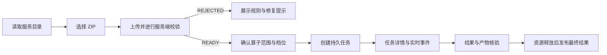
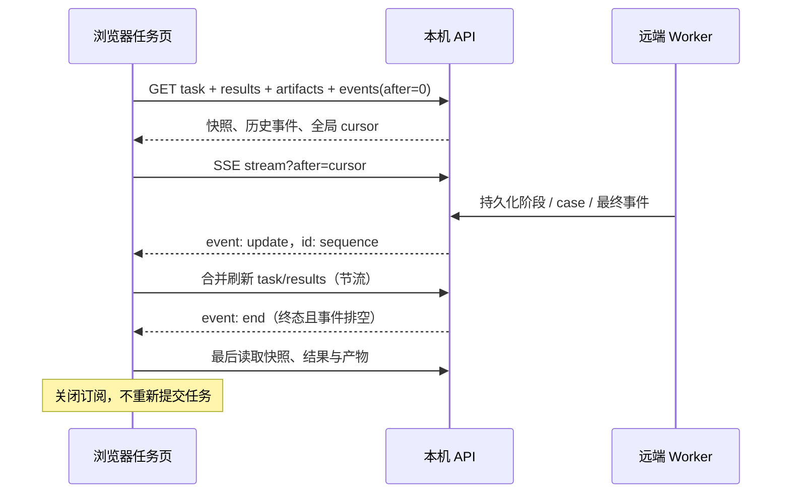

# 评测平台前端与接口联调方案

日期：2026-11-13。本文保留设计阶段的边界与推进顺序；之后已完成首版页面、P0 接口补齐和一次浏览器真机闭环，实施与验收状态见 [前端实施记录](frontend-implementation-20261113.md)。下文“待实施”描述的是方案制定时的缺口，不能替代实施记录。

本方案面向现有 Triton-Ascend 评测后端的首版 Web 工作台，借鉴 CANNBench 的评测集、提交、任务追踪与结果下钻。先交付可用的评测闭环，再扩展公开榜单与多人协作。首版部署在本机 loopback；它不是已经具备用户鉴权的公网服务。

依据：[CANNBench 调研](cannbench-platform-reference.md)、[远端 Worker 现状](remote-worker.md)、[SSH 稳定性验收](ssh-stability-review-20261113.md)、`submission_http.py` 和 `submission_service.py`。架构原稿中的“待实现”是历史记录，本方案的现状以当前代码为准。

## 1. 首版范围与页面结构

首要用户是提交算子实现、检查兼容性和定位失败原因的研发人员。核心路径是：了解接口要求 → 上传 ZIP 并校验 → 确认评测范围 → 创建任务 → 查看运行与结果 → 下载报告或修正后再次提交。

| 页面与拟定路由 | 用户要完成的事 | 首版数据来源与边界 |
| --- | --- | --- |
| 概览 `/` | 看到当前评测集、服务是否启用、最近任务，进入提交 | catalog + 最近任务；统计注明“最近加载的 N 条”，不伪称全站统计 |
| 评测集 `/benchmarks` | 搜索算子，查看签名、参数、权重和用例数量 | catalog；当前服务只绑定一个 corpus，版本只读展示 |
| 提交 `/submit` | 上传 ZIP、查看检查结果、选择算子及档位、创建任务 | submissions → evaluations；默认专项 + smoke |
| 任务列表 `/workspace/jobs` | 找到任务、查看状态和进度、继续查看历史 | evaluations 游标分页；首版不声称是“我的任务”，后端暂无用户隔离 |
| 任务详情 `/workspace/jobs/:id` | 跟踪阶段、逐 case 结果、分数和报告 | task + SSE/events + results + artifacts；执行中与完成后用同一路由 |
| 接入文档 `/docs` | 理解 ZIP 布局、算子约定、评分和故障处理 | 仓库规范与当前 API 契约；规范变更须同步校验器与页面 |

不在首版导航加入可操作的公开排行榜、团队、积分、Token 管理、私有提交、编译器安装或硬件切换。这些需要后端能力，不能仅靠页面实现。后续榜单按 corpus/hash、硬件、编译器 build、档位及评分口径分组，不能直接对现有任务列表排序充当正式榜单。

### 1.1 页面布局原则

采用桌面研发工作台：顶栏放导航、评测集版本和服务状态；内容页保留明确标题、主要操作及当前范围。任务详情承担主要信息密度，其他页面保持简洁。

- 提交页：上方为上传与校验；校验通过后展示算子和运行范围；旁侧摘要展示包指纹、预计用例数量、corpus 版本与档位。创建后跳转任务详情。
- 任务列表：表格展示 ID、创建时间、算子/范围、档位、任务状态、已完成/计划 case 数。分数不在每行额外发 results 请求，避免列表请求放大。
- 任务详情：顶部显示状态、范围、档位和操作；下方为阶段与进度；页签为“用例结果 / 运行事件 / 报告与产物 / 运行信息”。关键错误直接在页首展示。
- 用例表：算子、case_code、状态、误差、耗时、性能数据及日志下载；行展开查看异常摘要与原始测量字段。搜索和筛选基于当前已取回的结果，并注明范围。
- 普通页面不展示 SSH 配置、云凭据路径或启停脚本；高级运行信息可以展示 task/job ID、语料与包指纹、产物核验和资源释放状态，帮助复现与排障。

视觉方向待后续原型确认：优先浅色、清晰表格、稳定的状态色和可读的数字排版，保留 CANNBench 的清晰导航和逐层下钻。此文定义信息架构，不等于已经选定最终视觉稿。

### 1.2 空态、错误与可访问性

服务不可达、Worker 未启用、Worker 暂停、暂无任务、暂无结果、暂无性能成绩分别展示；不能都写成“加载失败”。错误保留后端 `code/rule_id` 与 `detail`，给出与错误匹配的下一操作。状态同时有文字和颜色；所有表单可键盘操作，上传和校验阶段有可读状态，事件自动滚动允许暂停。窄屏采用单列提交表单，宽表横向滚动，不隐藏关键错误。

## 2. 提交流程与状态口径



### 2.1 两个独立业务步骤

1. `POST /api/v1/submissions` 上传原始 ZIP 字节，Content-Type 为 `application/zip`。不使用 multipart/FormData，不在浏览器执行包内代码。浏览器上传进度只表示字节发送进度；发送到 100% 后显示“服务端校验中”。可用 XHR upload 的 progress 事件实现字节进度，见 [MDN](https://developer.mozilla.org/en-US/docs/Web/API/XMLHttpRequest/upload)。
2. HTTP 201 表示提交记录已保存，**并不等于校验通过**。先检查响应 `status`：只有 READY 才进入运行配置；REJECTED 展示 `errors[]`，不创建任务。错误可能属于 package 或 content 阶段。
3. `POST /api/v1/evaluations` 发送 `submission_id/scope/operators/profile`，202 后立即导航到任务详情；不等待 SSH 或评测结束。
4. 上传和创建使用两套独立 `Idempotency-Key`。同一次请求结果不明时，用相同键、相同内容重试；文件或请求参数改变后换新键。用户明确发起“再次评测”也使用新建任务键。不得因 SSE 断开自动再次提交或创建任务。
5. 刷新可以用 URL 中的 task_id 恢复详情；上传成功但尚未创建任务时，可在本浏览器会话保留 submission_id，重新 GET 提交验证其状态。后端目前没有提交历史列表接口。

首版上传按钮校验文件是否存在、后缀和传输大小，真正的 ZIP/内容合规仍由后端判定。当前限制来自 `submission_http.MAX_REQUEST_BYTES` 和 `package.py`：传输请求 ≤64 MiB、解压总量 ≤64 MiB、单文件 ≤8 MiB、条目 ≤2000、压缩比 ≤100、仅允许纯源码/文档后缀。**这不是 CANNBench 线上 10 MiB/50 MiB 的规则，也不支持编译器 wheel。** 这些限制尚未由 catalog 下发，是首批契约补齐项。

### 2.2 配置项的真实可用性

| 配置 | 当前规则 | 页面处理 |
| --- | --- | --- |
| corpus | 服务启动时绑定一个版本 | 从 catalog 展示版本和 manifest_hash，不做无效版本选择器 |
| operators 专项 | 默认使用已声明算子，可以缩小到非空子集 | 使用 submission.operators 与 catalog 的交集；显示每算子 case 数 |
| full 全量 | 不接受 operators 缩小范围，未实现算子也可能影响结果 | 高级试运行入口；明确全量尚未完成真机验收，不默认选择 |
| smoke | 已验收功能闭环，无性能成绩 | 默认选项；不能显示为“正式性能评测” |
| standard | 后端接受参数，正式性能与全量验收仍待完成 | 高级试运行入口，显式标注验收状态；不提供入榜承诺 |
| 硬件/编译器 | 由部署配置固定，当前请求不接受切换 | 无切换控件；API 暂未提供可核验的软件/硬件完整元数据 |

Worker 未启用时，仍可上传校验；页面默认禁用“开始评测”，说明只运行校验服务。接口测试可以创建 QUEUED，但页面不应让用户误以为任务会自动执行。Worker 暂停时也明确阻止新的普通运行操作；后端的最终校验始终保留。

### 2.3 展示三种相互独立的状态

| 层级 | 字段 | 展示规则 |
| --- | --- | --- |
| 任务流程 | task.status | 九态：QUEUED、RUNNING、SCORING、REPORTING、COMPLETED、REJECTED、FAILED、CANCELLED、INTERRUPTED |
| 用例判定 | cases[].status | 从模型枚举生成映射；PASS、编译/运行失败、结果错误、参考/环境异常等分别展示 |
| 资源释放 | task.remote.release_state | NOT_ACQUIRED / UNCONFIRMED / SHUTDOWN；未确认释放要显著提示 |

RUNNING 还包含准备、启动、连接、同步和计算。用 `remote.phase` 展示细分阶段，不根据前端计时猜测；可识别 preparing、starting、connecting、syncing、running、scoring、reporting、collecting、releasing、recovering 及终态。未知 phase 原样保留为高级信息并重新读取任务。

进度条是 `completed_cases/planned_cases` 的**用例进度**，不是全流程耗时百分比。用例达到 100% 后仍可能在收集、评分、报告或释放资源，继续显示当前阶段。取消运行后 `cancel_requested=true` 时显示“正在取消并释放资源”，等后端确认状态。

COMPLETED 表示流程完成，不保证全部用例 PASS。FAILED/INTERRUPTED 可能已有部分用例，保留可见结果；平台参考实现或环境异常不得写成“用户算法错误”。浏览器网络断开仅影响页面连接提示，不改任务为 FAILED。

### 2.4 分数展示

- 仅消费 `/results.score`，前端不复制评分公式。功能主分对应 `coverage_ops_core`，严格通过率对应 `coverage_strict`，静默错误数对应 `severe_count`。
- `score=null` 显示待生成或 `score_reason` 对应的原因；不能用 0 代替 null。实际 0 分照常显示。
- `performance_available=false` 或 `perf_score=null` 显示“暂无性能成绩”；smoke 明确说明不提供性能分。耗时字段不能擅自变成速度排名。
- 分数旁持续展示 corpus、manifest_hash、scope、profile 和计入用例数，避免专项成绩被误读为全量通过率。
- `certification.*=NOT_COMPUTED`、`full_suite_accepted=false` 显示“未完成认证/全量验收”；不生成绿色认证徽标。

## 3. 页面到后端的接口映射

所有业务地址使用相对路径 `/api/v1`；机器可读契约见 [当前 OpenAPI 快照](frontend-integration/openapi.json)。共有 13 个业务路径、14 个方法操作，另有 `GET /openapi.json`。此文件由现有代码生成，不是未来接口承诺。

| 操作 | 方法与路径 | 前端行为 |
| --- | --- | --- |
| 读取目录与 Worker 开关 | GET `/catalog` | 应用初始化、回到前台及运行操作前刷新；NOT_PROBED 不代表设备健康 |
| 上传 / 读取提交 | POST `/submissions`；GET `/submissions/{id}` | 区分记录保存和 READY/REJECTED |
| 创建 / 列举任务 | POST `/evaluations`；GET `/evaluations?before=…&limit=30` | 写操作幂等；列表倒序游标分页 |
| 任务快照 | GET `/evaluations/{id}` | 页面主状态真相源；刷新与事件触发时读取 |
| 实时订阅 | GET `/evaluations/{id}/stream` | 单详情一个 SSE，离开页面释放 |
| 补读事件 | GET `/evaluations/{id}/events?after=…` | 首次回放、SSE 降级及事件续读 |
| 结果与分数 | GET `/evaluations/{id}/results` | 运行中可展示已完成 case，最终分数等后端发布 |
| 取消 | POST `/evaluations/{id}/cancel` | 不乐观标记已取消，不自动当作资源已关停 |
| 补取原任务结果 | POST `/evaluations/{id}/recover` | `{"acknowledge_recovery":true}`；条件不满足会 409；可能重新启停原实例，不重新执行提交 |
| 解除 Worker 暂停 | POST `/worker/resume` | `{"acknowledge_health":true}`；仅本机运维区域，不能自动调用 |
| 产物列表与下载 | GET `/evaluations/{id}/artifacts`；GET `/evaluations/{id}/artifacts/{name}` | 使用服务端返回白名单名称；列表有 bytes/sha256；报告 HTML 默认下载 |

表中相对路径均接在 `/api/v1` 之后。当前没有任意远端文件浏览、任意命令、在线编译器安装或独立实时 stdout 接口。SSE 是结构化运行事件；完整日志通过 artifacts 下载。HTML 报告不能直接注入应用页面。

任务分页的 `next_cursor` 在本页非空时仍可能非 null，最后一次再请求才返回空页/null。首版按此实现“加载更多”；不能假定拿到短页就一定结束。状态/算子等筛选暂时只筛当前已加载数据并注明；后端补齐过滤前不提供全库搜索承诺。

## 4. SSE、快照与前端状态管理



1. 全局 `sequence` 是浏览器游标；`remote.event_seq` 是远端 job 内部序号，两者不能互换。全局序号存在其他任务造成的间隙，间隙不代表丢事件。
2. 第一次进入从 0 分页补读 `/events`，直到没有新增，渲染事件与已完成 case；随后连接 `stream?after=<最后已处理游标>`，边界处用 sequence 去重。快照可与回放并行，事件仅触发重新读取，不把旧事件状态覆盖到较新的任务快照。
3. 监听命名事件 `update` 和 `end`，不是只使用 `onmessage`。浏览器 EventSource 支持命名事件及 `close()`，见 [MDN](https://developer.mozilla.org/en-US/docs/Web/API/EventSource)。收到 `end` 后关闭并刷新最终快照/结果/产物；远端 envelope 的 `kind=final` 仍不等于本地任务已完成，后续还有收集和释放。
4. SSE 单连接最多 5 分钟，15 秒注释心跳，默认重连间隔 2 秒；断开不等于任务失败。EventSource 自身重连携带 Last-Event-ID；手动新建连接用 `?after=`。最多 8 条服务端连接，列表页不为每行建 SSE。
5. 详情页离开/切换任务关闭 SSE 和计时器；重复挂载不得产生两条活跃订阅。持续连接失败时关闭原订阅，退回 2–5 秒 `/events` 与 task 轮询，恢复后再切回，避免两套机制同时无界运行。
6. 批次最多 200 条，短批次不能直接推断 SSE 已终结。恢复的同一任务可从 FAILED/INTERRUPTED 回到 QUEUED，重开详情订阅后继续使用全局游标；不根据“终态永不可改变”写死 UI。
7. 用 case_code 去重；完整日志/产物不常驻全局 store。运行中按事件合并刷新 results（最多约 1 次/秒）；最终刷新与终态确认不依赖节流延迟。
8. 当前游标 JSON 为整数，协议接受 64 位值，浏览器 Number 仅安全表示到 2^53−1。接入层校验 `Number.isSafeInteger`，超限停止推进并提示协议升级；后端后续统一改字符串/不透明游标，不能默默舍入导致漏事件。

应用层建议使用 React + TypeScript + Vite 的本地 SPA，路由与服务端查询缓存分开管理，单独封装 API/上传/SSE。无需先引入 SSR、WebSocket 或重写 Python 后端。具体依赖版本在实际初始化时锁定；本轮未安装前端依赖。

建议后续目录按 `api/`（生成类型、request/upload/events）、`features/submissions/`、`features/jobs/`、`features/catalog/`、`components/`、`pages/` 划分。类型从 OpenAPI 生成；当前宽泛的 event schema 先通过适配层和运行时判定保护，不能直接强制断言为完整 case。

## 5. 同源开发与部署约定

当前 HTTP 适配器只接受 `Host=127.0.0.1:<后端端口>` 或 `localhost:<后端端口>`；有 Origin 时必须是 `http://<同一个 Host>`。它没有开放跨源或用户鉴权，直接从前端端口 fetch 后端会失败。

开发时浏览器统一访问前端本机入口，例如 `http://127.0.0.1:5173`，页面请求相对 `/api/v1` 和 `/openapi.json`；Vite 转发至 `http://127.0.0.1:8765`。Vite 支持路径代理和自定义代理钩子，参见 [官方 server.proxy 配置](https://vite.dev/config/server-options#server-proxy)。

**代理实现必须一起验收 Host 和 Origin。** `changeOrigin:true` 处理 Host，并不能替代当前服务的 Origin 校验。开发代理应先验证入站 Host 是预期前端 loopback authority，Origin（如存在）是该前端同源，再将获准请求的 Host/Origin 映射为后端 authority；其他来源直接拒绝。不能用无条件删 Origin、开放全部 CORS 或取消后端校验来解决。仅代理 `/api/v1` 与精确 `/openapi.json`，不提供任意目标地址代理。

SSE 代理要保持流式转发，不能缓冲到结束；代理超时要容纳服务端 5 分钟连接与浏览器正常续读。上传保留二进制请求体、Content-Type、Idempotency-Key 和正确 Content-Length；静态前端路由刷新需回退到 index.html，API 404 不得回退成 HTML。

打包后的本机版本复用经过测试的同源入口：入口提供静态文件并按相同规则代理 API，后端继续绑定 loopback。静态服务/反向代理目前尚未实现，是页面开发的首个工程项。迁移公网须先设计认证、授权、可信代理与部署边界，不能直接将当前适配器绑定 0.0.0.0。

## 6. 接口缺口与补齐顺序

“可开始前端开发”与“每项理想体验都有 API”是两回事。以下是本轮代码复核后发现的缺口，均明确为**待实施**，不是已经可调用的路由。

| 优先级 | 补齐项 | 原因与当前可行降级 |
| --- | --- | --- |
| P0：首屏联调 | 同源静态入口/开发代理及 SSE 透传 | 页面必须真实访问现有 API；开发阶段不改服务安全边界 |
| P0：提交页 | catalog 增加由校验常量生成的 submission_policy、profile 的验收/性能能力说明 | 避免前后端大小限制和 smoke 文案漂移；补齐前可按当前受控版本映射并由契约检查约束 |
| P0：详情页 | OpenAPI 补全 state/engine/health/final envelope 的结构与示例、cancel_requested/error 等事件字段 | 当前 remote 只是泛 object，生成类型不足以保证 case 解析；先以快照为真相源 |
| P0：操作区域 | 服务端计算 available_actions，含 cancel/recover 及不可用原因 | recover 的完整资格包含未公开条件；现阶段仅在运维区域提供受限尝试并处理 409，普通页面不推断一定可恢复 |
| P1：工作台 | 服务端任务过滤、summary/count、按需返回列表投影 | 当前列表按任务读取结果，历史变多后成本上升；首版小范围分页与“已加载数据”筛选 |
| P1：可复现性 | 经过脱敏与校验的运行环境信息、设备型号与编译器 build 指纹 | 现有 catalog 没有可信完整环境信息；不在 UI 写死当前机器版本 |
| P1：运维 | Worker 暂停原因、队列概况、最近探针时间和结构化错误分类 | catalog 目前只是开关/暂停标志且 device_health=NOT_PROBED，不能冒充在线资源数量 |
| P1：协议长期使用 | 字符串/不透明游标兼容迁移、契约版本与自动生成检查接入 CI | 当前本地低量级可用，但需防整数精度与契约漂移 |
| P2：平台化 | 鉴权/用户隔离、团队配额、编译器构建管理、跨提交性能锚点与正式榜单 | 明确单独设计与验收，不以首版 UI 占位等同后端已完成 |

不另建第二套评分器，不让前端直连 CANNLab、SSH 或本机 hub。资产传输、保活、重连、取消与关停归 Worker；页面关闭不停止任务，也不停止 Worker 的租约心跳。

## 7. 联调阶段与退出条件

| 阶段 | 工作 | 通过标准 |
| --- | --- | --- |
| A：契约与设计 | 确认页面范围、生成当前 OpenAPI/响应样例、任务状态与错误映射；随后选视觉原型 | 页面控件都有对应接口或明确禁用原因；样例不冒充 NPU 成绩 |
| B：无 NPU 联调 | 启动 execute=false 服务；完成同源代理、上传/拒收/幂等、创建/分页/取消、SSE 终态关闭与降级 | 浏览器网络里真实经过后端；无上传/任务重复；合法代理通过且非同源请求仍被拒绝 |
| C：结果与异常 UI | 使用明确标识的测试数据覆盖 0 分、null 分、COMPLETED 但有失败 case、ORACLE_FAIL、取消等待释放、recover 409 | 页面准确区分任务完成、用例通过、评分可用和资源释放；无虚构性能/认证 |
| D：有界真机端到端 | 用现有已验收的小专项 ZIP，经页面执行真实 remote Worker；刷新/断开前端 SSE，再恢复查看 | 同一 task/job，无重新 launch；case 无重复，分数与后端一致，报告/日志可下载，产物核验通过，最终 SHUTDOWN |
| E：首版交付 | 核验浏览器行为、构建、路由刷新、键盘操作、空态与错误；记录 API 和前端版本 | 提交→运行→结果全流程可交互；明确仍未验收的 full/standard，不宣称生产全功能就绪 |

阶段 B 不启动 NPU，避免为 UI 开发反复消耗实例时间；D 只在页面及代理通过后执行。此前真机验收是后端验收，不能代替尚未发生的浏览器端到端验收。

必须覆盖的交互场景：ZIP 损坏/路径违规、201+REJECTED、413/415、幂等重试与冲突、创建请求响应丢失、Worker disabled/paused、队列取消、运行取消、SSE 刷新重连及 5 分钟轮换、200 条以上事件回放、网络断开、任务中断与原任务补取、日志尚不存在、报告下载、性能 null、页面离开后无订阅泄漏。

## 8. 本轮落地物与复核方式

- 本方案：页面结构、状态口径、页面/API 映射、同源策略、缺口和联调验收。
- [OpenAPI 快照](frontend-integration/openapi.json)：由当前 `submission_http.openapi()` 生成。
- [响应样例](frontend-integration/examples.json)：当前 EvaluationService 无 Worker 的真实本地调用输出，ID/时间归一化；覆盖 READY、REJECTED、QUEUED、CANCELLED、待评分、空产物及 409。
- `frontend-integration/submission-valid.zip`：仅用于上传与静态校验的 Exp 源码包，函数返回输入，**不是正确 Exp 实现，不得用于声称 NPU 通过**。
- `scripts/platform_examples/export_frontend_contract.py`：临时服务导出与 `--check` 漂移检查；不启用 Worker、不使用凭据、不启动 NPU。

在现有 Python 3.11+ 开发环境中运行（本工作区已验证的环境为 `.venv/pattern-build/bin/python`）：

```sh
PYTHONPATH=src python scripts/platform_examples/export_frontend_contract.py
PYTHONPATH=src python scripts/platform_examples/export_frontend_contract.py --check
PYTHONPATH=src python -m pytest tests/test_submission_http.py -q
```

不启用 Worker 的浏览器联调后端启动方式：

```sh
PYTHONPATH=src python -m triton_eval.submission_http \
  --root runs/frontend-integration \
  --corpus corpus/v0.18-scan-certification-candidates \
  --port 8765
```

真机阶段复用 [远端 Worker 启动约定](remote-worker.md)，单独使用本机私有配置和服务目录。不要把 UI 联调目录里积累的 QUEUED 任务直接切为 remote 模式：服务会将遗留排队任务纳入远端队列。无 Worker 阶段的测试任务应取消或始终隔离其数据目录。

本轮复核：导出后 `--check` 通过；HTTP 专项 **7 passed、无跳过**，包含真实 loopback 下前端 Origin 被拒、后端同源被接受、Host 不匹配被拒的检查。未实现开发代理、未做浏览器联调、未启动 NPU，不能将该结果算作阶段 B/D 完成。

下一实施顺序：先补 P0 契约与同源入口，再做提交页和任务详情的视觉原型及实现，随后补任务列表、评测集、概览和文档；每个页面接真实接口，最终从浏览器完成一次有界真机验收。
