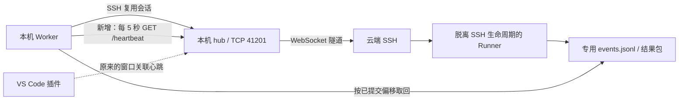

# SSH 链路复盘与稳定性加固（2026-11-13）

结论：第 6 轮执行后无法读回事件的主要原因已经定位并复现——**平台没有独立续租本机转发 hub**。插件停止发送心跳后，hub 按既有策略正常退出，SSH 的本机 TCP 入口随之消失。不能把这些失败统称为“SSH 不稳定”，也没有证据证明是 VS Code 本体随机故障。另有启动/连接接入、后台进程、打包和评测参考侧的独立问题，必须分开归因。

## 1. 实际链路与三种心跳

三个保活机制互不替代：

- **hub HTTP 心跳**：维持本机转发进程。安装的 1.1.2 实现每 10 秒检查一次；距离最后 `/heartbeat` 达 35 秒且没有活动转发连接就退出；有活动连接时阈值为 10 分钟。普通 `/version`、连接准备或 SSH 文件轮询不更新这个时间。
- **SSH ServerAlive**：检查既有 SSH 对端是否响应，不能刷新本机 hub 的 HTTP 租约。
- **Runner 事件心跳**：表示评测进程仍在推进，保存在远端事件文件；网络断开时本机收不到，并不证明 Runner 已停止。

原先每两秒新开一次 SSH 取文件，两个连接之间往往没有活动转发，恰好暴露了 35 秒回收条件。判断“启动就绪”是一次检查，不能替代整个任务期间持有 hub 租约。

## 2. 确认原因的原始证据

以下时间是北京时间，原日志按 UTC 保存：

| 时间 | 事实 |
|---|---|
| 10:24:05.003 | 插件最后一次 `hubHeartbeat.resp`，hub 收到 `/heartbeat` |
| 10:24:40.596 | 原 hub 记录 `heartbeat inactive` 并退出 |
| 10:25:27.400 | bootstrap 新拉起 hub |
| 10:25:59 左右 | 脚本确认 SSH 就绪 |
| 10:26:17.298 | 新 hub 再次因无心跳退出，早于任务结束 |
| 10:26:47–10:27:06 | 原任务数据库记录真实执行起止，run_status=OK，20 PASS |
| 10:27:09.474 | 远端任务已完成报告与完整结果 |
| 10:27:53 左右 | 本机连续读回失败后进入 finally stop；此前本机没有收到 case 事件 |

因此，原任务完成时间早于首次关停，也早于后续恢复；恢复并没有重跑出一份新成绩。不能从插件心跳停止推断用户主动关闭窗口、插件崩溃或整个 VS Code 崩溃，日志只足以证明那一路心跳停止。

受控 A/B 使用原插件 hub 脚本副本，只重定向数据目录，未修改计时器或协议、未修改真实插件或真实 hub，没有启动 NPU：

| 实验 | 结果 |
|---|---|
| 无心跳，仍每秒 GET `/version` | 41.56 秒退出，证实普通 API 流量不续租 |
| 同一 SDK，每 5 秒 GET `/heartbeat`，无 VS Code/SSH 活动连接 | 65 秒仍存活，13 次心跳成功、零失败 |
| 停止该心跳 | 总计约 101.75 秒正常退出，回收机制仍有效 |

原 SDK SHA-256：`3f776b76f555a7fd5a05af2417ce80a711669a0cd14ffd89dbe9c4f269b093a0`。SDK 的自动回收是明确的生命周期约定；缺陷在平台接入时把其保活责任留给了 VS Code 窗口。真实插件文件未被修改。

证据：`runs/ssh-stability-20261113/prior-connection-timeline.jsonl`、`local-hub-ab.json`；原始日志仍保留在本机 SDK 目录。抽取文件不含 WSS 地址、Token 或原始认证头。

## 3. 上轮成功与失败分别是什么

原始六轮新任务验收全部留下了失败终态；一次显式恢复成功。不能把“最终恢复成功”表述为“六轮都一次成功”，也不能把四种不同的错误都归咎于 SSH。

| 轮次 | 实际结果 | 归因与状态 |
|---|---|---|
| 1 | 云端已运行，SSH 未就绪，无 case | 连接准备路径不完整；当时没有完整 stderr，无法断言单一底层原因 |
| 2 | 启动远端后台进程的 SSH 等到超时 | 脚本后台 AND-list 持有通道描述符；已改为明确分离会话和标准流的 Popen，有独立进程测试 |
| 3 | REMOTE-PREPARE，无 case | 连接验证失败；旧诊断不够细，不能证明是 VS Code 故障，现已补诊断与有界核验 |
| 4 | 20 PASS，但 ENGINE-REPORT；取回 27 个产物 | 整包漏了 Jinja 模板；已补 bundle 与 wheel package-data，并以隔离子进程生成报告验证 |
| 5 | 19 PASS + 1 ORACLE_FAIL；25 个下载哈希全符 | 参考输入一致性检查报“参考实现修改了输入”，与 SSH 断开分开；根因未定，未改冻结判定掩盖问题，未发布成功分数 |
| 6 | 云端实际 20 PASS 且已生成报告，本机传输中断 | hub 心跳缺失、主动回收；本轮已定位并复现 |
| 恢复 6 | 同一 job、同一 run，20 PASS；29 个产物哈希全符，SSE 续读无重复；COMPLETED 后 SHUTDOWN | 正式 recover 入口仅取回旧事件/产物，不同步、不调用 launch，证明结果可恢复；不等于原始连接全过程稳定 |

上轮单元/集成专项 187 passed；整套 L0 一次结果为 1410 passed、3 failed、1 skipped、445 deselected，另有 21 subtests passed。三项失败是已有 codecheck_revision 缺失 migration_metadata.py，与 SSH 无关。

## 4. 本次已经实施的优化

1. **Worker 自己持有 hub 心跳租约**：本机 `cann_retry.VscodeHubLease` 在实例启动前开始、直到关停确认后结束；每 5 秒发心跳，动态读取 hub PID/端口并验证协议，不再依赖窗口是否继续发心跳。统计成功/失败、最大间隔和 hub 变化次数。连接函数自身的长等待也被租约覆盖。
2. **无窗口启动工具有明确生命周期**：`--run --connect-vscode --keep-vscode-alive` 可持续保活，受 `--duration` 限制；Ctrl-C 结束保活，保留工具原有“不擅自停止实例”语义。评测 Worker 独立负责 finally 与看门狗。旧脚本备份在 `~/cann-lab-http-retry/backup-20261113-stability/`。
3. **每个任务独占 SSH 复用会话**：保存在短路径、0700 临时目录中，私有 ControlPath；一次解析插件有效配置，形成 0600 临时快照，保留原认证和主机检查设置，避免每次轮询都触发 `Match !exec` bootstrap。重连时重新解析，结束后关闭并删除本任务 master，不关闭用户自己的 SSH 会话。[OpenSSH 会话复用文档](https://man.openbsd.org/ssh_config#ControlMaster)。
4. **不再丢弃 SSH stderr**：`ssh-diagnostics.jsonl` 持久化操作、耗时、退出码、分类与脱敏尾部。区分通道丢失、认证失败、主机身份失败和远端程序退出；认证/主机检查/远端程序错误不通过反复刷新隧道掩盖。255 在本项目固定读文件命令中作为传输失败信号，不能泛化成任意远端命令的绝对判定。
5. **只自动重试可安全重放的操作**：事件读取与下载在同一实例租约内刷新通道并重建私有会话；总恢复预算默认 90 秒、最多三次尝试。下载重试会重新写入未发布的临时包，之后照常校验大小和 SHA。不自动重复 start、同步、launch，不生成第二份运行。
6. **网络超时与评测心跳分开**：恢复网络所耗时间不算成 Runner 无事件时间；整个实例仍受总预算和独立停机看门狗约束。无法恢复则保留偏移/原始文件、失败并释放实例，之后可以显式 recover。

实现：`src/triton_eval/ssh_transport.py`、`orchestrator.py`，以及外部 `~/cann-lab-http-retry/cann_retry.py`。冻结 corpus、参考、容差、评分公式均未改动。

## 5. 验证与界限

本轮本机专项：**196 passed，无跳过**。外部启动工具：**45 项测试通过，无跳过**，包括真实 loopback HTTP 下跨三倍空闲 TTL 的租约存活/释放。SDK 原版定时器 A/B 实测通过。

真机验证的完整结果位于 `runs/ssh-stability-20261113/real-stability-summary.json` 和各 cycle/result.json：第一轮主动终止本任务私有 SSH master 一次，验证相同 job 自动续读；第二轮重新冷启动且不注入故障。两轮都严格校验 case 集合、产物哈希、SSE 游标和 launch 次数；终态以结果文件中的 success/final_cloud_state 为准。

这些检查消除了已复现的 hub 自退出，并覆盖正常与主动断连路径；不能承诺任意网络永不掉线。首次插件登录/Trust、有效 OAuth/连接资产仍是准入条件；独立心跳不续签已经失效的 OAuth。本机休眠/断电、上游网络中断、SDK 协议升级和未查明的 ORACLE_FAIL 仍分别处理，不用增加重试次数或放宽判定来掩盖。

本轮真机最终结果：

| 冷启动轮次 | SSH 故障 | 执行与恢复 | 校验与释放 |
|---|---|---|---|
| 1，主动注入断连 | 1 次预定的私有 master 退出；同 Job 自动重连，2 个会话代次 | 20 PASS，launch=1，完整五阶段状态链；SSE 20 条事件断开后续读、无重复 | 29 个产物大小/SHA 全符，COMPLETED，SHUTDOWN |
| 2，无注入 | 0 次 SSH 失败，1 个会话代次 | 20 PASS，launch=1，完整五阶段状态链；SSE 20 条事件续读无重复 | 29 个产物大小/SHA 全符，COMPLETED，SHUTDOWN |

hub 两轮均零重启，成功心跳最大间隔分别 5.011 / 5.093 秒。第一轮开始时有 6 次 hub 尚未就绪的探测失败；首次成功心跳之后未再出现超过约 5 秒的心跳间隔，最后错误为空。第二轮 40 次心跳全成功。对第一轮可见的唯一 SSH 失败，应按 controlled-reset 注入事件归因，不能计成非预期网络故障。

另补了首次 SSH 读超时也计入 90 秒恢复预算的边界测试，最终传输定向检查 10 passed；196 项后端检查和 45 项脚本检查不是对 1385 case / standard 性能的替代。本轮全部实例已确认 stopped/SHUTDOWN。
